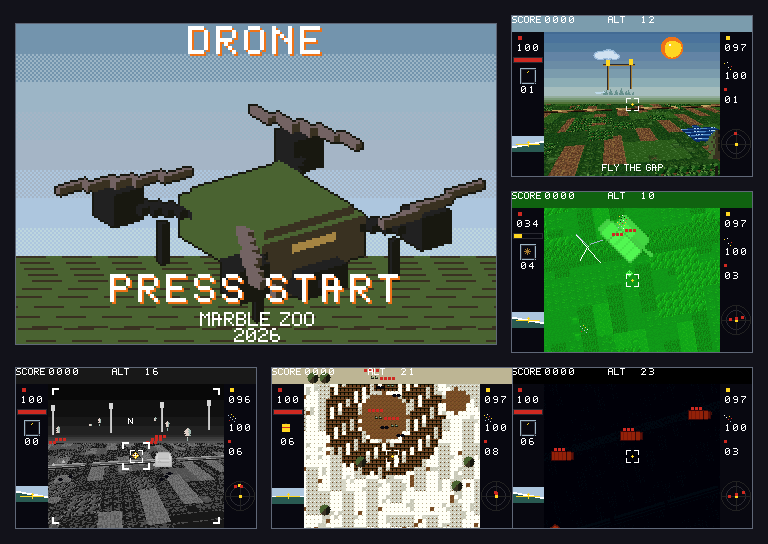

# DRONE



How to play, with pictures of every glass and aircraft: [docs/GUIDE.md](docs/GUIDE.md).

A reconnaissance aircraft for the Game Boy Advance. The cartridge is **`aircraft.gba`**. It opens in the official mGBA.

The field is fictional: grass, dirt tracks, trenches. The sky and the instruments do not repeat the map. The opening card is the title. Credits run after the last mission.

Four aircraft. The spotter holds altitude and calls a salvo. The general-purpose drone carries a large set of charges and flies forward; **Select** switches it to a top-down view and a slow slide, and Select again restores the previous nose. The mine quadcopter of missions 27, 28, 29 and 33 always slides, and **Select** only changes the view: speed stays the same and grows while a direction is held. FPV is a kamikaze, with a wire running ahead to the charge. The top view is a shaded plan: a tank shows tracks, and a turret set back on the hull with its hatch on top. A mine, bomb, high explosive, and VOG leave the aircraft with the aircraft's own speed. The crosshair is where the nose meets the ground, in the forward glass and in the overhead picture. An empty battery drops the aircraft, and the impact ends the sortie. **Start** opens pause: Resume continues the sortie, Exit returns to level select. Level progress is written to the save. A cleared level can be selected again.

## Glass

- Day. A cycles the charge, B releases it. Any blast hits infantry inside its radius. A bomb takes trucks and finishes a tank in three nearby hits. VOG is infantry only. High explosive takes bunkers. Any charge except the bullet takes a tank on the first hit if it lands in the hatch. A mine nearby finishes a tank in two hits.
- Fuel. Drums stand on the dirt beside the roads and next to some targets. A blast near them or a burst of the gun sets them off, and their own blast takes what stands close, the next dump included. A charge in a tank's hatch sets off the rounds inside: the turret flies, the bursts follow, and the hull burns. Trucks catch fire too.
- Night. The same aircraft, through green glass. Bodies glow, the ground does not.
- Heat. Cold ground, hot vehicles and bunkers.
- Guidance. Grey glass, no bombs. A light frame lies on the ground under the sight: it is part of the map and stays put when the camera leaves. B locks it. Four seconds later a salvo of six rockets arrives. The flash is white and only at the impact point. The spotter moves at the same speed as the infantry on a rush, and does not reach the posts before they do.
- Winter. Cards 34 to 40. White snow, green pines, brown mud. This glass does not switch to night or heat.

In mGBA the d-pad is the cross, X is A, Z is B, Return is Start, and Backspace is Select. On the mine quad, Select turns the glass forward: up climbs, down descends, and left and right turn. Looking down, the cross still slides.

A cleared card keeps three marks. Yellow is earned, red is still open, and a mark stays once it is earned. The first is a quick finish. The second is the battery still at 30 or above when the task ends. The third is a spare load: few releases, a drone still in hand on a kamikaze card, no return to the pad on the gate, and half the airframe left when only the bullet is used. On a cleared day card, after any night card and any heat card are done, up and down change the glass. The task stays the same. Night lights the bodies on a dark field. Heat leaves the ground cold and the bodies hot.

## Missions

Ten of the forty are stage cards: one task, then a flight to the next. The briefing names both, a line under the glass names the stage in hand, and the radar turns to the next targets once a stage is clear.

1. First flight. Hover over the mark, drop one bomb, then descend to 12 and fly between the posts. One extra bomb still clears.
2. Officer. One marked man.
3. Trench. Six soldiers in a line.
4. Headquarters. Break the marked tiles.
5. Convoy. Do not let the truck reach the posts.
6. Cut off. Two stages. Stop the convoy's truck before the posts, then fly east and break the house it was driving for.
7. Night. Three trucks in a short row.
8. Heat. Three trucks, farther north and wider apart.
9. Night scout. Fly low, at 14 or under, over three marked points; white corners on the ground and yellow dots on the radar show them. Then bomb the three trucks the pass found.
10. Guidance. Three parked trucks. The salvo lands under the sight, including from far away.
11. Column, guidance. Trucks crawl, so the mark has to lead them.
12. Armour, night. Three tanks far apart. Three bombs near each one are enough. A charge in the hatch takes a tank at once. The bullet does not.
13. Bunkers, heat. Three bunkers. High explosive takes them. They fire if you descend.
14. Hot trail, heat. Low over three marks, then shell the three bunkers on the trench line beyond them.
15. FPV. Four drones, four pairs. When the drones run out, the mission starts over.
16. Lane, day. Under 20 a gun sees the drone only inside its circle, and the radar marks the clear air. At 20 and above the guns lose the drone. The trucks are at the end of the lane.
17. Silent guns. Three batteries cover a tank park. They see only under 20, so bomb each one from above that. With the guns down, fly low and put mines in the two hatches.
18. Rush, guidance. Infantry run for the base posts. Place the mark ahead of the group: during the rockets' flight they walk into it.
19. Flare, night. The same lane, three tanks. Put the charge in the hatch.
20. Nest, FPV. Four men stand in the open gaps. Fly the drone onto them.
21. Dart, FPV, heat. Three trucks in the same gaps.
22. Dark pass, FPV, night. Ram the two guns, then the three trucks behind them.
23. Push, guidance. Three groups: a truck and two men beside it. One mark per group, ahead of it. The right-hand group is first: it is closer to the posts, and the salvo reaches it from the pad.
24. Last stop, guidance. Mark three parked trucks; their crews then run from the wrecks for the posts.
25. Skirt, heat. Three bunkers past the lane.
26. Bend, guidance. The spotter cannot climb, so it stays in the guns' sight. Only the lane and the salvo remain.
27. Lift. A quadcopter, looking straight down from the start. Select turns the glass forward: down sets it on the ground, and left and right turn. B on a mine picks the round up. Up climbs clear, then B over a tank hatch drops it. Looking down, the cross slides. Six rounds: three near the pad, three farther south and clear of the tanks. Two charge pads sit clear of the tanks, a dark tile in a concrete square, and they show yellow on the radar. Sit on one and the battery climbs. Speed depends on how long the stick is held.
28. Haul. The same, with the mines and tanks farther out. While a mine is in the claws, the radar shows the tanks.
29. Mine run. One tank near the pad, then two past a pair of guns, with a second cache of rounds on the way.
30. Swarm. Four hostile quads at one height, and two delta-wing drones farther out and lower. Climb and the quads are underneath: the picture grows as they get nearer. The wings are wider, so they stay a shape when a quad has shrunk. Drop onto a height and a close pass is a collision. Only the bullet brings one down. Above you, they are not in the glass. A hit far away is a small flash.
31. Crows. Six hostile quads come at the pad one after another, and two delta-wing drones come from farther north, slower. You start above them, so they are already in the glass, nearer ones larger. The crosshair has to sit on the picture: that is where the bullet goes. The yellow radar mark is the base. Shoot them down before one reaches the concrete. On their height a close pass is a collision. Only the bullet brings one down. A hit far away is a small flash.
32. Cover. One truck crawls for the posts. Two quads ride above it. Two delta-wing drones do not hover: they fly a straight lane, north to the posts and back south, and they are already in the glass. You start at the quads' height, so climb before the quads show. The bullet takes only the aircraft. A cycles to the bomb, and the bomb takes the truck. The yellow radar mark is the posts. If the truck reaches them the sortie ends, even with the aircraft already down. On their height a close pass is a collision. A hit far away is a small flash.
33. Night courier, mine quad, night. Two tanks east of the pad, then one north behind two guns.
34. Ash pits. Eight men in two trench lines, standing in pairs: one grenade takes a pair. Ash and snow beyond.
35. Snow wood. Eight men in pairs, on the mud and then in the burned wood. Above 20 the rifles do not see the pass.
36. White search, winter. Low over three marks in the snow, then grenade two pairs on the mud.
37. Snow road. A truck drives north, and the card fails if it arrives. Only a bomb takes it. Three men stand on the mud beside the road.
38. Mud iron. Three tanks hold still on three islands to the north. Four men stand together on their own mud well south of the pad, inside one grenade.
39. Cold convoy, winter. Stop the truck on the snow road, then mine the two tanks waiting on the mud.
40. Pine post. An officer and four men stand still on the mud. Below 20, inside the post's circle, the guns fire. Above 20 the pass is quiet.

## Build

Requires the nightly from `rust-toolchain.toml` and the `agb` crate 0.25.

```sh
cargo build --release
agb-gbafix target/thumbv4t-none-eabi/release/aircraft -o aircraft.gba
```

`vendor/agb_image_converter` is agb's image converter with sprite palettes sorted by brightness; upstream shuffles them on every build, and the night, heat and infrared glass read a colour's index as its brightness. See `vendor/README.md`.

The ELF is packed into `aircraft.gba` by `agb-gbafix` (`cargo install agb-gbafix`). The image must begin with the bytes `2e 00 00 ea`.

The trucks, tanks, bunkers and soldiers are voxel models in `tools/voxel.py`, drawn to their sheets from every heading the game uses; `python3 tools/voxel.py` writes them into `gfx/`, and `--preview` puts enlarged copies in `target/voxel/` instead. Every sheet shares one fifteen-colour palette made of colours other sprites already use.

The briefing pictures of the stage cards are cut from the first thirty by `python3 tools/stills.py`: the first stage above a diagonal, the second below it.

`cargo test --release --features screens` draws the guide's pictures into `target/screens/`; `python3 tools/screens.py` doubles them into `docs/screens/`, and `python3 tools/cover.py` builds `cover.png` from them.

`cargo run --release` opens the ELF in mGBA. `cargo test --release` runs headless in `mgba-test-runner`; `tools/run.sh` picks between the two. The suite flies every card with a stick pilot and draws twelve flights through each glass, so it takes several minutes. The flight drawing prints a digest per card and the cycles spent on the floor, the objects and the ground map.
