# How to play DRONE

DRONE is a reconnaissance and strike drone for the Game Boy Advance. Each card is one sortie: take off from the pad, find the marked targets, and clear them before the battery runs out. Thirty cards make one campaign, from a first training flight to snow sorties against a watched post.

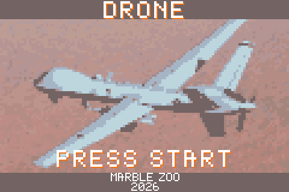

## Running it

Open `aircraft.gba` in [mGBA](https://mgba.io). It also runs on a flash cartridge. Progress is kept in the save: the furthest card reached, the cleared cards, their marks and the chosen glass.

| GBA | mGBA keyboard | In flight |
| --- | --- | --- |
| D-pad | Arrow keys | Left and right turn. Down dives toward the ground, up climbs. |
| A | X | Cycle the charge: bomb, high explosive, mine, grenade, gun. |
| B | Z | Release the charge, fire the gun, or lock the mark. |
| Select | Backspace | Change the view; on the quadcopter, between looking ahead and looking down. |
| Start | Return | Pause: Resume carries on, Exit goes back to the cards. |

On the cards, left and right pick the sortie and Start flies it. Once a day card is cleared, and a night card and a heat card have been cleared somewhere in the campaign, up and down change that card's glass.

## The briefing card

Every sortie opens on a card: the number and name, the aircraft and the glass, the two lines of the task, the three marks earned so far and a picture of the target.

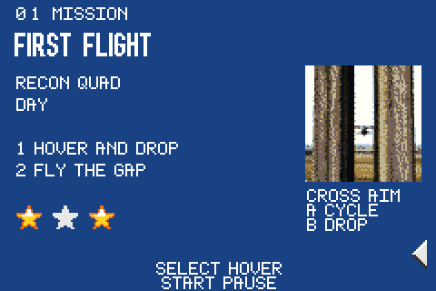 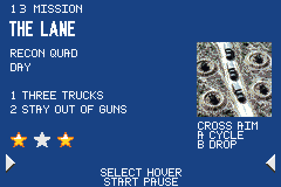

## The screen

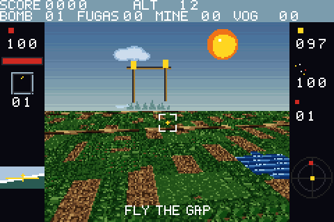

- **Top line**: score and height. Height matters: charges scatter more the higher they are released, and low passes wake up guns and rifles.
- **Second line**: what is left of each charge, bombs, `FUGAS` (high explosive), mines and `VOG` grenades.
- **Left column**: hull strength and its bar, the charge in hand and how many of it remain. Under 40 the glass cracks.
- **Right column**: battery, signal, and the number of marked targets still standing. The yellow dot is the target counter.
- **Bottom left**: the attitude indicator.
- **Bottom right**: the radar. It turns with the aircraft, so ahead is up; targets are dots, and a yellow mark is the base or the posts the card talks about.
- **The crosshair** is where the nose meets the ground. That is where a released charge falls, allowing for the drone's own speed.

An empty battery drops the aircraft and the impact ends the sortie. Losing the signal turns the glass to static.

## The aircraft

- **Quadcopter.** The general-purpose drone. It flies forward with the nose; Select looks straight down and lets it slide over the map, Select again brings the nose back. It carries bombs, high explosive, mines and grenades, and on some cards a gun. On card 24, Select sets it down on the pad as a gun turret instead: the glass stays along the barrel, and the cross turns and tilts it.
- **Mine quadcopter** (cards 21 and 22). It always slides. Looking down, the cross moves it; Select turns the glass forward, where down lands it and left and right turn. Land on a mine and B picks it up, climb, and B over a tank's hatch drops it. Charge pads, a dark tile in a concrete square, refill the battery while it sits on them.
- **Spotter.** Holds its height and cannot climb. A frame lies on the ground under the sight; B locks it, and four seconds later six rockets land there. Lead moving targets: the salvo lands where the frame was, not where the target is.
- **FPV.** A kamikaze. The drone is the charge: fly it into the target. When the drones run out, the card starts over.

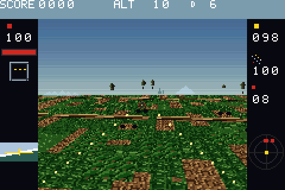 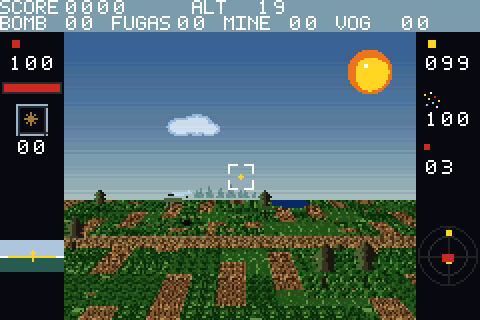

## Charges

| Charge | Takes |
| --- | --- |
| Bomb | Trucks. Three nearby hits finish a tank. |
| High explosive (`FUGAS`) | Bunkers. |
| Mine | Two nearby hits finish a tank. |
| Grenade (`VOG`) | Infantry only. |
| Gun | The man or the drone under the crosshair, looking ahead. Looking straight down it does not fire: it lies along the nose. On the cover card, only the aircraft. |

Any blast hits infantry inside its radius, and any charge except the gun takes a tank at once if it lands in the hatch. Charges leave the aircraft with its speed, and the higher the release, the wider they scatter: a grenade the least, high explosive the most.

## The glass

The same field through five sensors. The task never changes with the glass; only what you can see does.

| Glass | What it shows |
| --- | --- |
| Day | The field in colour, sun and clouds. |
| Night | Green phosphor. Bodies and vehicles glow, the ground and the trees stay dark. |
| Heat | Cold ground, hot vehicles, bunkers and men. |
| Guidance | Grey infrared for the spotter: no bombs, only the frame and the salvo. |
| Winter | Cards 26 to 30: white snow, green pines, brown mud. This glass cannot be switched. |

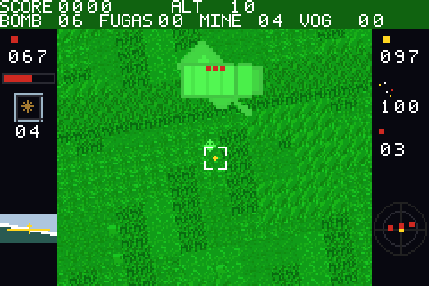 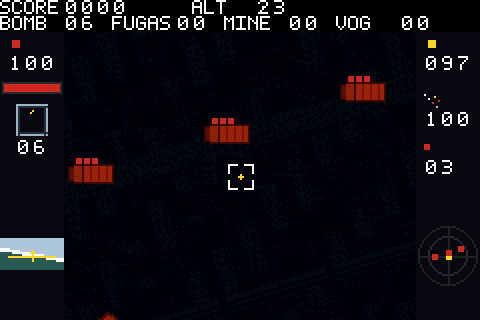

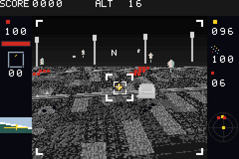 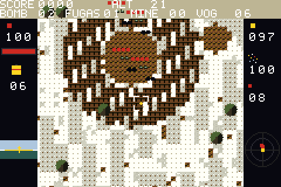

## Marks

A cleared card keeps three marks. Yellow is earned, red is still open, and a mark stays once it is earned.

1. A quick finish.
2. The battery still at 30 or above when the task ends.
3. A spare load: few releases, a drone still in hand on a kamikaze card, no return to the pad on the first card, or half the airframe left when only the gun is used.

## The campaign

| No. | Card | Glass | Aircraft | Task |
| ---: | --- | --- | --- | --- |
| 1 | First flight | day | quadcopter | Hover over the mark and drop one bomb, then descend to 12 and fly between the posts. |
| 2 | Officer | day | quadcopter | One marked man. |
| 3 | Trench | day | quadcopter | Six soldiers in a line. |
| 4 | Headquarters | day | quadcopter | Break the marked roof tiles. |
| 5 | Convoy | day | quadcopter | Stop the truck before it reaches the posts. |
| 6 | Night | night | quadcopter | Three trucks in a short row. |
| 7 | Heat | heat | quadcopter | Three trucks, farther north and wider apart. |
| 8 | Guidance | guidance | spotter | Three parked trucks. |
| 9 | Column | guidance | spotter | Crawling trucks: lead them with the frame. |
| 10 | Armour | night | quadcopter | Three tanks far apart. The hatch takes one at once. |
| 11 | Bunkers | heat | quadcopter | Three bunkers. High explosive takes them; they fire if you descend. |
| 12 | FPV | day | FPV | Four drones for four pairs. |
| 13 | Lane | day | quadcopter | Trucks at the end of a lane of guns. Above 20 the guns lose you. |
| 14 | Rush | guidance | spotter | Infantry running for the posts: put the frame ahead of them. |
| 15 | Flare | night | quadcopter | Three tanks beyond the lane. |
| 16 | Nest | day | FPV | Four men in the gaps of the lane. |
| 17 | Dart | heat | FPV | Three trucks in the same gaps. |
| 18 | Push | guidance | spotter | Three groups, a truck and two men each. The right-hand group first. |
| 19 | Skirt | heat | quadcopter | Three bunkers past the lane. |
| 20 | Bend | guidance | spotter | A low spotter in the guns' sight; only the lane and the salvo. |
| 21 | Lift | day | mine quadcopter | Six mines, three tanks, two charge pads. |
| 22 | Haul | day | mine quadcopter | The same, farther out. With a mine in the claws, the radar shows the tanks. |
| 23 | Swarm | day | quadcopter, gun | Four hostile quads and two delta wings. Only the gun brings them down. |
| 24 | Crows | day | quadcopter, gun | Drones come at the pad one after another. Keep them off the concrete. |
| 25 | Cover | day | quadcopter, gun | A truck crawls for the posts under two quads and two wings. |
| 26 | Ash pits | winter | quadcopter | Eight men in two trench lines, in pairs: one grenade a pair. |
| 27 | Snow wood | winter | quadcopter | Eight men in pairs on the mud and in the burned wood. |
| 28 | Snow road | winter | quadcopter | A truck heading north and three men beside the road. |
| 29 | Mud iron | winter | quadcopter | Three still tanks to the north, four men well south of the pad. |
| 30 | Pine post | winter | quadcopter | An officer and four men at a watched post. Stay above 20. |

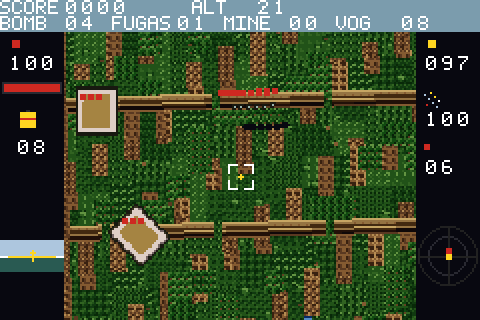 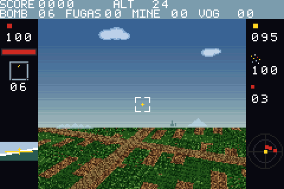

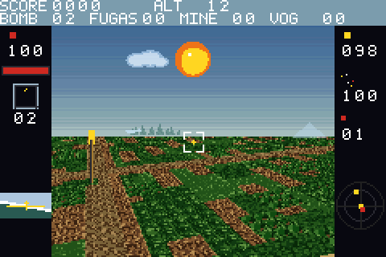 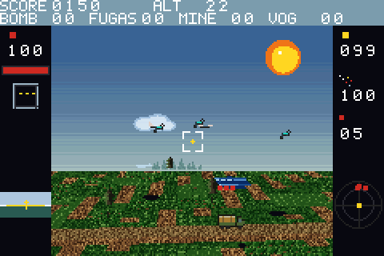

## Tips

- Hover before a precise drop. A charge released while flying keeps the drone's speed.
- On armour cards, aim for the hatch: one charge in it beats three beside the hull.
- Guns and rifles only see you low. Climb above 20 to cross a lane, and come down only over the target.
- The spotter's salvo takes four seconds. Put the frame where the target will be.
- Watch the battery on long cards. Hovering spends less than flying.
- After the last card the credits roll, and every card stays open to fly again for its marks.

---

The pictures are drawn by the game itself: `cargo test --release --features screens`, then `python3 tools/screens.py`. See the README for building.
