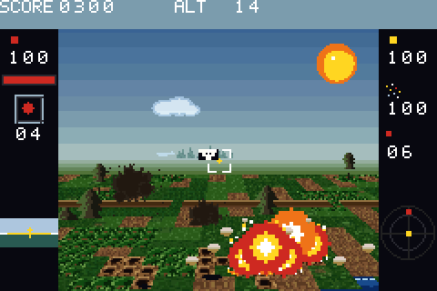
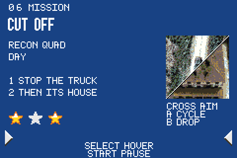
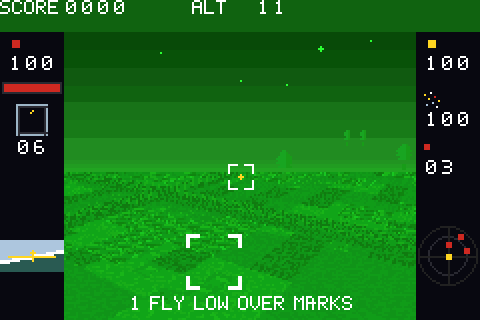
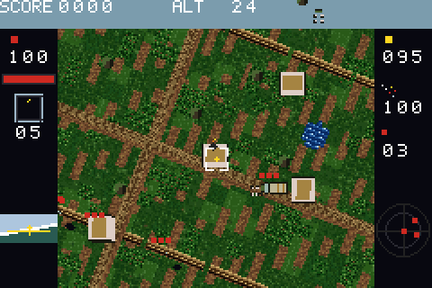

# How to play DRONE

DRONE is a reconnaissance and strike drone for the Game Boy Advance. Each card is one sortie: take off from the pad, find the marked targets, and clear them before the battery runs out. Forty cards make one campaign, from a first training flight to snow sorties against a watched post. Ten of them are stage cards: one task, then a flight to the next.

## Running it

Open `aircraft.gba` in [mGBA](https://mgba.io). It also runs on a flash cartridge. Progress is kept in the save: the furthest card reached, the cleared cards, their marks and the chosen glass.

| GBA | mGBA keyboard | In flight |
| --- | --- | --- |
| D-pad | Arrow keys | Left and right turn. Down dives toward the ground, up climbs. |
| A | X | Cycle the charge: bomb, high explosive, mine, grenade, gun. |
| B | Z | Release the charge, fire the gun, or lock the mark. |
| Select | Backspace | Change the view; on the quadcopter, between looking ahead and looking down. |
| Start | Return | Pause: Resume carries on, Exit goes back to the cards. |

On the cards, left and right pick the sortie and Start flies it. Once a day card is cleared, and a night card and a heat card have been cleared somewhere in the campaign, up and down change that card's glass.

## The briefing card

Every sortie opens on a card: the number and name, the aircraft and the glass, the two lines of the task, the three marks earned so far and a picture of the target.

 

## The screen

- **Top line**: score and height. Height matters: charges scatter more the higher they are released, and low passes wake up guns and rifles.
- **Left column**: hull strength and its bar, the charge in hand and how many of it remain; A cycles through the others to see theirs. Under 40 the glass cracks.
- **Right column**: battery, signal, and the number of marked targets still standing. The yellow dot is the target counter.
- **Bottom left**: the attitude indicator.
- **Bottom right**: the radar. It turns with the aircraft, so ahead is up; targets are dots, and a yellow mark is the base or the posts the card talks about.
- **The crosshair** is where the nose meets the ground. That is where a released charge falls, allowing for the drone's own speed.

An empty battery drops the aircraft and the impact ends the sortie. Losing the signal turns the glass to static.

## The aircraft

- **Quadcopter.** The general-purpose drone. It flies forward with the nose; Select looks straight down and lets it slide over the map, Select again brings the nose back. It carries bombs, high explosive, mines and grenades, and on some cards a gun. On card 31, Select sets it down on the pad as a gun turret instead: the glass stays along the barrel, and the cross turns and tilts it.
- **Mine quadcopter** (cards 27, 28, 29 and 33). It always slides. Looking down, the cross moves it; Select turns the glass forward, where down lands it and left and right turn. Land on a mine and B picks it up, climb, and B over a tank's hatch drops it. Charge pads, a dark tile in a concrete square, refill the battery while it sits on them.
- **Spotter.** Holds its height and cannot climb. A frame lies on the ground under the sight; B locks it, and four seconds later six rockets land there. Lead moving targets: the salvo lands where the frame was, not where the target is.
- **FPV.** A kamikaze. The drone is the charge: fly it into the target. When the drones run out, the card starts over.

 

## Charges

| Charge | Takes |
| --- | --- |
| Bomb | Trucks. Three nearby hits finish a tank. |
| High explosive (`FUGAS`) | Bunkers. |
| Mine | Two nearby hits finish a tank. |
| Grenade (`VOG`) | Infantry only. |
| Gun | The man or the drone under the crosshair, looking ahead. Looking straight down it does not fire: it lies along the nose. On the cover card, only the aircraft. |

Any blast hits infantry inside its radius, and any charge except the gun takes a tank at once if it lands in the hatch. Charges leave the aircraft with its speed, and the higher the release, the wider they scatter: a grenade the least, high explosive the most.

## Fuel and fire

Fuel dumps, four green drums with pale lids and one lying in front, stand on the dirt beside the roads and next to some targets. Any blast close to them, or a burst of the gun, sets them off: a ball of fire, then their own blast a moment later, which takes trucks, men and tanks standing close, and the next dump if it is near. A dump beside the target is a charge you did not have to carry.

A charge in a tank's hatch sets off the rounds inside: a white flash, the turret thrown high, a string of bursts and then the fuel. A truck's tank catches a moment after the hit. Wrecks burn and smoke for a while after.

## The glass

The same field through five sensors. The task never changes with the glass; only what you can see does.

| Glass | What it shows |
| --- | --- |
| Day | The field in colour, sun and clouds. |
| Night | Green phosphor. Bodies and vehicles glow, the ground and the trees stay dark. |
| Heat | Cold ground, hot vehicles, bunkers and men. |
| Guidance | Grey infrared for the spotter: no bombs, only the frame and the salvo. |
| Winter | Cards 34 to 40: white snow, green pines, brown mud. This glass cannot be switched. |

 

 

## Stage cards

A stage card asks for two things, one after the other, in different places on the field. The briefing names both. In flight, a line under the glass names the stage in hand while it is new; clear it and the next stage opens: its targets come up on the radar, the counter starts again, and the charge for it is put in hand.

Two kinds of stage are new:

- **Scout.** Fly low, at 14 or under, over each of the marked points. Four white corners on the ground show where they are, and the radar shows them in yellow. What the pass finds is the next stage.
- **Guns.** The batteries are the targets. They see only what is under 20, so a bomb dropped from above that height is out of their reach. Once a battery is down, its circle is gone from the radar and the air over it is safe to fly low. A kamikaze takes a battery by ramming the ground beside it.

 

## Marks

A cleared card keeps three marks. Yellow is earned, red is still open, and a mark stays once it is earned.

1. A quick finish.
2. The battery still at 30 or above when the task ends.
3. A spare load: few releases, a drone still in hand on a kamikaze card, no return to the pad on the first card, or half the airframe left when only the gun is used. On a stage card it counts both stages together.

## The campaign

| No. | Card | Glass | Aircraft | Task |
| ---: | --- | --- | --- | --- |
| 1 | First flight | day | quadcopter | Hover over the mark and drop one bomb, then descend to 12 and fly between the posts. |
| 2 | Officer | day | quadcopter | One marked man. |
| 3 | Trench | day | quadcopter | Six soldiers in a line. |
| 4 | Headquarters | day | quadcopter | Break the marked roof tiles. |
| 5 | Convoy | day | quadcopter | Stop the truck before it reaches the posts. |
| 6 | **Cut off** | day | quadcopter | Stop the truck, then fly east and break the house it was driving for. |
| 7 | Night | night | quadcopter | Three trucks in a short row. |
| 8 | Heat | heat | quadcopter | Three trucks, farther north and wider apart. |
| 9 | **Night scout** | night | quadcopter | Low over three marks, then bomb the three trucks they found. |
| 10 | Guidance | guidance | spotter | Three parked trucks. |
| 11 | Column | guidance | spotter | Crawling trucks: lead them with the frame. |
| 12 | Armour | night | quadcopter | Three tanks far apart. The hatch takes one at once. |
| 13 | Bunkers | heat | quadcopter | Three bunkers. High explosive takes them; they fire if you descend. |
| 14 | **Hot trail** | heat | quadcopter | Low over three marks, then shell three bunkers on the trench line. |
| 15 | FPV | day | FPV | Four drones for four pairs. |
| 16 | Lane | day | quadcopter | Trucks at the end of a lane of guns. Above 20 the guns lose you. |
| 17 | **Silent guns** | day | quadcopter | Bomb three batteries from above 20, then mine the two tanks they guarded. |
| 18 | Rush | guidance | spotter | Infantry running for the posts: put the frame ahead of them. |
| 19 | Flare | night | quadcopter | Three tanks beyond the lane. |
| 20 | Nest | day | FPV | Four men in the gaps of the lane. |
| 21 | Dart | heat | FPV | Three trucks in the same gaps. |
| 22 | **Dark pass** | night | FPV | Ram the two guns, then the three trucks behind them. |
| 23 | Push | guidance | spotter | Three groups, a truck and two men each. The right-hand group first. |
| 24 | **Last stop** | guidance | spotter | Mark three parked trucks, then stop their crews running for the posts. |
| 25 | Skirt | heat | quadcopter | Three bunkers past the lane. |
| 26 | Bend | guidance | spotter | A low spotter in the guns' sight; only the lane and the salvo. |
| 27 | Lift | day | mine quadcopter | Six mines, three tanks, two charge pads. |
| 28 | Haul | day | mine quadcopter | The same, farther out. With a mine in the claws, the radar shows the tanks. |
| 29 | **Mine run** | day | mine quadcopter | One tank near the pad, then two past a pair of guns, from a second cache. |
| 30 | Swarm | day | quadcopter, gun | Four hostile quads and two delta wings. Only the gun brings them down. |
| 31 | Crows | day | quadcopter, gun | Drones come at the pad one after another. Keep them off the concrete. |
| 32 | Cover | day | quadcopter, gun | A truck crawls for the posts under two quads and two wings. |
| 33 | **Night courier** | night | mine quadcopter | Two tanks east of the pad, then one north behind two guns. |
| 34 | Ash pits | winter | quadcopter | Eight men in two trench lines, in pairs: one grenade a pair. |
| 35 | Snow wood | winter | quadcopter | Eight men in pairs on the mud and in the burned wood. |
| 36 | **White search** | winter | quadcopter | Low over three marks in the snow, then grenade two pairs on the mud. |
| 37 | Snow road | winter | quadcopter | A truck heading north and three men beside the road. |
| 38 | Mud iron | winter | quadcopter | Three still tanks to the north, four men well south of the pad. |
| 39 | **Cold convoy** | winter | quadcopter | Stop the truck on the snow road, then mine the two tanks waiting on the mud. |
| 40 | Pine post | winter | quadcopter | An officer and four men at a watched post. Stay above 20. |

Stage cards are in bold. A save from the thirty-card cartridge carries over: cleared cards and their marks stay, and the stage cards before the furthest card reached are open.

 

 

## Tips

- Hover before a precise drop. A charge released while flying keeps the drone's speed.
- On armour cards, aim for the hatch: one charge in it beats three beside the hull.
- Guns and rifles only see you low. Climb above 20 to cross a lane, and come down only over the target.
- The spotter's salvo takes four seconds. Put the frame where the target will be.
- Watch the battery on long cards. Hovering spends less than flying.
- After the last card the credits roll, and every card stays open to fly again for its marks.

---

The pictures are drawn by the game itself: `cargo test --release --features screens`, then `python3 tools/screens.py`. See the README for building.
